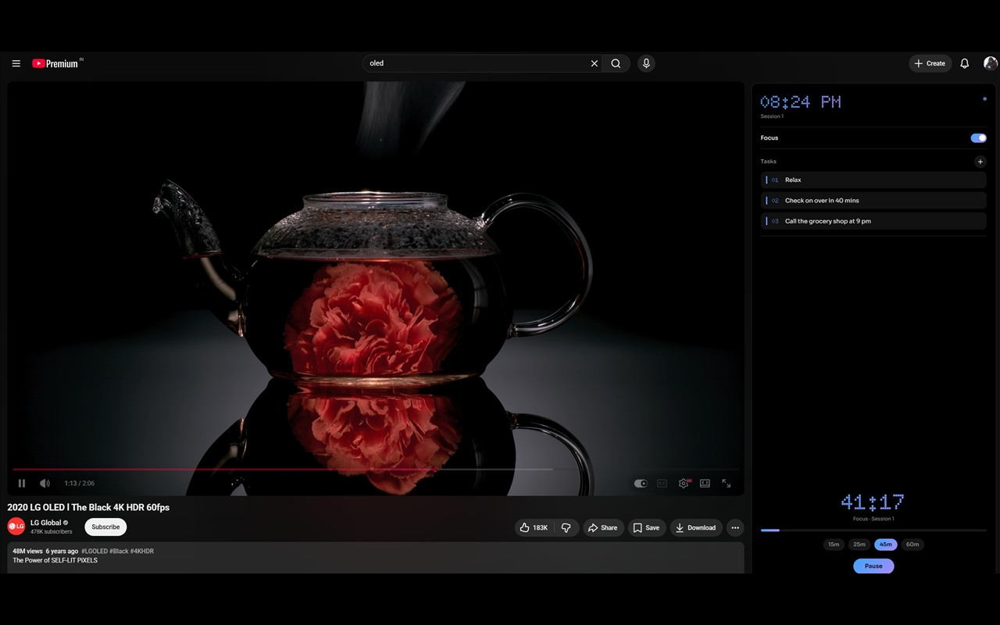
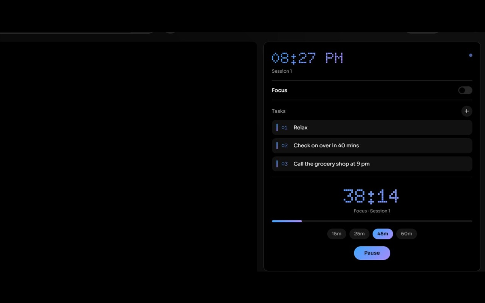

# ClearFeed

**ClearFeed** turns YouTube into a focus tool. It hides the feeds that pull you off-course, and puts a Pomodoro timer, session tasks, and daily stats right beside the video — in an OLED-black dashboard that tints itself to your chosen gradient theme.

**[Install from the Chrome Web Store](https://chromewebstore.google.com/detail/clearfeed/pjhhcihepfhbglmkokbbiakkdnbaoiep)**

## Features

### Focus dashboard (watch pages)
- **Pomodoro timer** that runs in a background service worker — it keeps counting across tabs, reloads, and navigation, shows the minutes left on the toolbar badge, and sends a notification when a session or break ends. Breaks start after every focus session, with a long break every fourth.
- **Session tasks** — a lightweight numbered task list; completed tasks strike through and clear themselves.
- **Dot-matrix clock** and countdown set in Doto, with Sora for UI text (both bundled).

### Distraction removal
Pure CSS injection, zero lag. Individually toggleable from the popup:
- Shorts (everywhere)
- Related videos sidebar, playlists, and live chat
- Comments
- Home feed
- End cards
- Notification bell

### Gradient themes
Six presets — Aurora, Sunset, Mint, Rose, Gold, Ember — selectable from the popup. The clock, timer, toggles, chips, and buttons all follow, and the choice syncs across your devices.

### Zen mode
Replaces the YouTube homepage with a single search box. Search with intention.

### Weekly stats
Focus time, sessions completed, tasks done, and Shorts hidden — charted for the week in the popup.

## Installation

**Chrome Web Store (recommended):** [ClearFeed](https://chromewebstore.google.com/detail/clearfeed/pjhhcihepfhbglmkokbbiakkdnbaoiep)

**Manual / development:**
1. Clone or download this repository (or grab the zip from [Releases](https://github.com/xcyberpunkx0/ClearFeed/releases)).
2. Open `chrome://extensions/` and enable **Developer Mode**.
3. Click **Load unpacked** and select the project root.

## Tech

- Vanilla JavaScript, Manifest V3
- Background service worker owns the timer, badge, notifications, and stats; views read state from `chrome.storage` and re-render on change
- CSS-only distraction removal, gated per-setting
- MutationObserver engine coalesces YouTube's DOM churn into one sync per frame
- Bundled fonts: [Sora](https://fonts.google.com/specimen/Sora), [Doto](https://fonts.google.com/specimen/Doto) (OFL)

## Privacy

Everything stays on your machine. No analytics, no external requests — see [PRIVACY_POLICY.md](PRIVACY_POLICY.md).

## License

ClearFeed is provided for personal productivity use.
